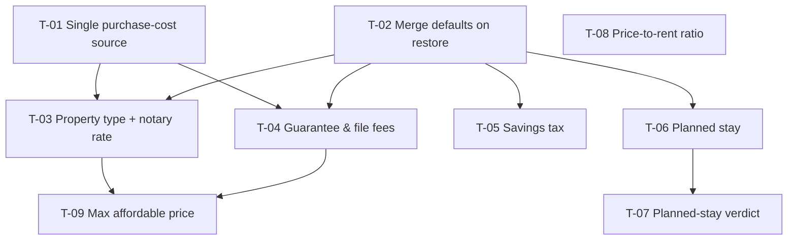

# Kanban: Résidence Principale — sharper buy-vs-rent verdict (Wave 1)

## Source
`docs/forge/rent-vs-buy-decision/prd.md` + `research.md`. Plans the six Wave 1 additions to the Résidence Principale page:

- neuf/ancien notary rate
- guarantee and file fees
- planned stay vs break-even
- renter savings tax
- price-to-rent ratio
- maximum affordable price

Out of scope, per PRD non-goals: DPE, stress scenarios, PTZ, DVF price lookup, department-specific notary rates, the Rendement Locatif page. Owner confirmed a 30 % savings-tax default (PRD §9.1 settled).

Built-state check: git history up to `50c592a` and the current page code show none of these six built.

## Build order & critical path
1. **Foundations:** T-01 (single purchase-cost source) and T-02 (saved-value merge) run in parallel.
2. **Inputs:** T-03 (property type + notary) and T-04 (guarantee fees) run in parallel. Independently, T-05 (savings tax), T-06 (planned stay) and T-08 (ratio) can start as soon as their blockers clear.
3. **Then:** T-07 (planned-stay verdict) and T-09 (max affordable price).

**Critical path:** T-01 → T-03 → T-09 = 3 + 2.5 + 2.5 = **8h**.

**Total effort:** 19.5h across 9 tickets.

**Parallelizable:**
- T-02, T-05, T-06, T-07 and T-08 sit off the critical path.
- T-04 is off it by 0.5h of slack.

## Graph checks
1. **Node count:** 9 nodes in the graph, 9 tickets. ✔
2. **Symmetry:** every Blocks/Blocked-by pair was matched both ways (listed in the edge table below). ✔
3. **Acyclic:** the edges only point from lower to higher ticket numbers, so no cycle is possible. ✔
4. **No redundant edges:** T-09 depends on T-03 and T-04 but not directly on T-01/T-02, which it already reaches through them. T-07 depends only on T-06. ✔
5. **Critical path:** earliest finishes are T-01 3, T-02 1, T-03 5.5, T-04 5, T-05 4, T-06 4, T-07 5.5, T-08 1, T-09 8. The maximum is 8 (T-09), traced back through T-03 (5.5 > T-04's 5) to T-01 (3 > T-02's 1). Estimates sum to 19.5h. ✔

Edge table: T01→T03, T01→T04, T02→T03, T02→T04, T02→T05, T02→T06, T06→T07, T03→T09, T04→T09.

## Findings that changed the plan
- **The purchase-cost maths is written twice.** It lives inside the simulation (`app/residence-principale/page.tsx:80-84`) and again in the page body (`:415-418`). PRD M1 requires a single source, so T-01 consolidates it before any fee is added. Otherwise each new fee would have to be added twice, and the two could drift apart.
- **Fees beyond the down payment are lost, not financed.** The down payment is reduced by fees but floored at 0, and the loan is computed as price minus that remainder (`:83-84`). If fees exceed the down payment, the excess silently disappears from the cost. This contradicts PRD §7, and T-01 fixes it.
- **The renter's portfolio has no record of what was paid in.** It is a single running value (`:109`, `:142`, `:149`). Taxing only gains (PRD story D) needs the contributions tracked separately, which is folded into T-05's estimate. The same applies to the buyer's surplus (`:110`, `:150`).
- **The chart already draws a break-even marker as a vertical reference line** (`components/patrimoine-chart.tsx:85`). A second marker for the planned stay reuses that mechanism, so T-06 stays small.
- **A saved restore replaces the whole state** (`hooks/use-local-storage.ts:14`), as research.md predicted. T-02 is needed before any new field ships.
- **The "before tax" wording exists** (`page.tsx:1048`). T-05 owns rewriting it.

## Requirement coverage

| PRD requirement | Owner |
|---|---|
| §5 Performance: full recompute < 50 ms at 40-yr horizon | T-05 (simulation change), re-checked in T-06 |
| §5 Accessibility: labels tied to fields | T-03, T-04, T-05, T-06 (each for its inputs) |
| §5 Accessibility: segmented control keyboard + announced state | T-03 |
| §5 Accessibility: states in text, 4.5:1 contrast both themes | T-08, T-09 |
| §5 Correctness regression baseline | T-01 (establishes), T-05 (tax 0 % reproduces) |
| §5 Persistence reliability | T-02 |
| §5 Privacy: no data leaves the browser | T-02 |
| §7 Zero/empty rates valid | T-03, T-04, T-05 |
| §7 Planned stay 0/empty → horizon | T-06 |
| §7 Comparable rent 0 → dash | T-08 |
| §7 Down payment smaller than fees → financed | T-01 |
| §7 No break-even within horizon | T-07 |
| §7 Planned stay > horizon | T-06 |
| §7 Affordability impossible | T-09 |
| §7 Out-of-range entries clamped | T-03, T-04, T-05, T-06 |
| §7 Old saved simulations | T-02 |
| §7 Time-sensitive defaults labelled "valeur indicative" | T-03, T-04, T-05 |

No requirement is left without an owner.

## Tickets

### [T-01] Single source for purchase costs, and finance fees beyond the down payment
- **Serves:** PRD M1, §7 down-payment edge case, §5 regression baseline
- **Description:** consolidate the purchase-cost derivation so the simulation, the summary, the non-recoverable totals and the budget chart all read one computation: fees, the share of the down payment left for the property, and the loan amount. Change the behavior so that fees exceeding the down payment are added to the loan instead of vanishing.
- **Definition of Done:**
  - Purchase costs are computed in exactly one place, and every consumer on the page reads it.
  - With the default inputs, every figure on the page matches the current release to the euro. Record the baseline figures in the PR: monthly payment, loan amount, break-even year, net worth at horizon for both, non-recoverable total.
  - With a down payment smaller than total fees, the loan increases by the shortfall, and the monthly payment and debt ratio reflect it.
- **Blocked by:** none · **Blocks:** T-03, T-04
- **Size:** M · **Estimate:** ~3h

### [T-02] Merge defaults into restored saved simulations
- **Serves:** PRD story G, M5, §5 persistence and privacy
- **Description:** when a saved simulation is restored, fill any field it lacks from the defaults and keep every saved value.
- **Definition of Done:**
  - A simulation saved by the current release (no new fields) loads with all prior values intact, and new fields take their defaults. Verified by saving on the current release and loading after the change.
  - No input renders empty or "NaN" because a key was missing.
  - The page still renders only after the restore, with no animated jump on load.
  - No network request is made with simulation data (checked in the browser network panel).
- **Blocked by:** none · **Blocks:** T-03, T-04, T-05, T-06
- **Size:** S · **Estimate:** ~1h

### [T-03] Property type (existing / new build) driving an editable notary rate
- **Serves:** PRD story A, M1, M5
- **Description:** add a two-option property-type control with the purchase inputs, and an editable notary-rate field next to it. Defaults: 7.8 % for existing, 2.5 % for new build. Switching type resets the rate to that type's default; a manual edit holds until the next switch. The notary rate replaces the fixed 7.8 % everywhere through T-01's single source.
- **Definition of Done:**
  - Existing is preselected. Switching sets 7.8 % or 2.5 %, and a manual edit persists across reloads until the type is switched.
  - Every notary-fee figure on the page (summary, purchase tab, non-recoverable total, simulation) uses the rate.
  - The rate field's hint explains the gap between the two types and says the default is a "valeur indicative". Notary fees keep the "non récupérable" tag.
  - The control follows the project's segmented-control rule: one persistent surface with a sliding selection.
  - The control is operable with Tab and the arrow keys, shows a visible focus ring, and a screen reader announces the selected option.
  - A 0 % rate is accepted. Rates above 100 % or negative are clamped, and the field shows the value used.
- **Blocked by:** T-01, T-02 · **Blocks:** T-09
- **Size:** M · **Estimate:** ~2.5h

### [T-04] Guarantee and file fees
- **Serves:** PRD story B, M1, M5
- **Description:** add an input for guarantee and file fees as a percentage of the amount borrowed, default 1 %. The hint shows the euro amount. The fees are added to up-front costs through T-01's single source.
- **Definition of Done:**
  - The default is 1 %, and the hint shows the euro amount updating live.
  - The field is tagged "non récupérable", and the hint says "valeur indicative".
  - The fees appear in the purchase costs and in the non-recoverable total, and they reduce the down payment or increase the loan exactly like notary fees, including the T-01 shortfall rule.
  - 0 % is accepted; out-of-range values are clamped, and the field shows the value used.
- **Blocked by:** T-01, T-02 · **Blocks:** T-09
- **Size:** S · **Estimate:** ~2h
- **Notes:** the fee depends on the loan, which depends on fees. Base it on the loan before this fee to avoid a circular calculation; the rounding difference is negligible.

### [T-05] Tax on the renter's (and buyer's surplus) investment gains
- **Serves:** PRD story D, M2, §5 performance and regression
- **Description:** add a "fiscalité sur les gains de l'épargne" input to the market assumptions, default 30 %. In the simulation, track contributions separately from value for both invested portfolios, and at each comparison year count net worth as value minus the tax on (value − contributions). The owner's resale stays untaxed. Rewrite the assumptions note to state the rate used, and to say the main-residence gain is exempt.
- **Definition of Done:**
  - At 0 %, every figure matches the T-01 baseline exactly.
  - At 30 %, the renter's net worth at the horizon equals contributions plus 70 % of gains (spot-checked by hand for one year).
  - The tax never applies to contributions, and never to the owner's home equity.
  - The assumptions note no longer says "avant impôt" and states "plus-value de la résidence principale exonérée" plus the current rate.
  - A full recompute at a 40-year horizon takes under 50 ms (measured with the browser performance panel on the dev machine).
  - The input's hint says "valeur indicative"; out-of-range values are clamped.
- **Blocked by:** T-02 · **Blocks:** none
- **Size:** M · **Estimate:** ~3h

### [T-06] Planned stay: input, net-worth gap at that year, chart marker
- **Serves:** PRD story C (inputs, summary, chart), M2, M5
- **Description:** add a "durée prévue dans le logement" input next to the horizon, defaulting to the horizon. The simulation exposes the buy-vs-rent net-worth gap at the planned-stay year. The summary shows that gap, and the net-worth chart marks the planned-stay year with a marker visually distinct from break-even. Handle a planned stay longer than the horizon. Either extend the horizon or cap the stay with a message; the build decides (PRD §9.6).
- **Definition of Done:**
  - With the planned stay equal to the horizon, existing figures are unchanged.
  - The summary shows the gap at the planned stay, labelled with the year.
  - The chart shows two distinguishable markers, break-even and planned stay, each with a text label (not colour alone).
  - A planned stay of 0 or empty falls back to the horizon.
  - A planned stay longer than the horizon never produces a comparison at an uncomputed year.
  - The recompute stays under 50 ms at 40 years.
- **Blocked by:** T-02 · **Blocks:** T-07
- **Size:** M · **Estimate:** ~3h

### [T-07] Verdict uses planned stay vs break-even
- **Serves:** PRD story C (recommendation), M3, §7 no break-even
- **Description:** extend the recommendation logic. After the existing affordability rules (35 % debt ratio, minimum remaining budget), compare the planned stay with the break-even year:
  - break-even after the planned stay, or never: lean toward renting
  - break-even within the stay: favourable, stating the margin

  Explanations name both numbers.
- **Definition of Done:**
  - The affordability rules still win when they trigger (verified with a debt ratio above 35 %).
  - Planned stay 6 with break-even 12 gives a renting verdict whose text cites "6 ans" and "année 12".
  - Planned stay 20 with break-even 12 gives a favourable verdict stating an 8-year margin.
  - No break-even within the simulated period gives a verdict saying buying does not pay off in that period, with no invented year.
- **Blocked by:** T-06 · **Blocks:** none
- **Size:** S · **Estimate:** ~1.5h

### [T-08] Price-to-rent ratio indicator
- **Serves:** PRD story E, M4
- **Description:** show the purchase price ÷ the comparable annual rent, in years with one decimal, near the key metrics. Add an interpretation band: below 20 favours buying, 20–25 is neutral, above 25 favours renting (PRD §9.5 thresholds, owner to validate).
- **Definition of Done:**
  - 300 000 € price with 1 200 €/month rent shows "20,8 ans" and the neutral band.
  - The band is conveyed in text, and the text meets 4.5:1 contrast in light and dark themes.
  - Rent of 0 shows a dash, with no error or "Infinity".
- **Blocked by:** none · **Blocks:** none
- **Size:** S · **Estimate:** ~1h

### [T-09] Maximum affordable price
- **Serves:** PRD story F, M4, §7 affordability impossible
- **Description:** when income is entered, show in "Ma situation financière" the highest purchase price at which the loan payment (with borrower insurance) plus existing credits reaches 35 % of net income. It uses the current rate, loan length, down payment, notary rate and guarantee fees. Compare it with the listing price: "dans votre budget", or "dépasse de X €".
- **Definition of Done:**
  - Recomputing the debt ratio at the displayed maximum price gives 35.0 % ± 0.1 pt.
  - It updates live with any relevant input, including property type and guarantee rate.
  - Existing credits ≥ 35 % of income, or a zero loan length, shows "aucun financement possible", never a negative or infinite price.
  - It is hidden when income is empty.
  - The within-reach state is conveyed in text with 4.5:1 contrast in both themes.
- **Blocked by:** T-03, T-04 · **Blocks:** none
- **Size:** M · **Estimate:** ~2.5h
- **Notes:** fees depend on price, so solve for price rather than reusing the payment formula forward. Either a closed form or a short bisection meets the DoD.

## Delivery
Commit per ticket, push to `main`, then a production deploy to Vercel (`simulateur-immo-nine.vercel.app`) once all nine are merged. Not counted in the effort or the critical path.

## Flagged for the user
- **Price-to-rent thresholds (20 / 25 years)** are rules of thumb, still unvalidated (PRD §9.5). T-08 uses them as is.
- **Fees beyond the down payment were silently dropped** in the current release (finding above). T-01 changes this, so simulations with a small down payment will show a higher loan and payment after the update. This is intended.
- **Planned stay longer than the horizon:** extend vs cap is left to the build (PRD §9.6).

## Dependency graph

